<div align="center">

# Amherst Run (native)

**A cel-shaded arcade driving game set in the real town of Amherst, Nova Scotia, in C++ for the Xbox, Android and Linux.**

[](https://github.com/jeremylegere-wq/amherst-run-native/actions/workflows/ci.yml)
[](https://github.com/jeremylegere-wq/amherst-run-native/releases)
[](LICENSE)
%20%7C%20Android%20%7C%20Linux-blue)

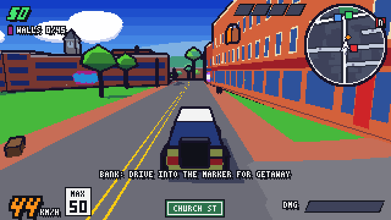

</div>

> [!WARNING]
> **Untested on real hardware.** The Xbox and Android builds come straight from CI and have not yet been played on a
> console or a phone. The Linux build runs on a desktop and passes its tests. Expect rough edges, and see
> [Reporting a problem](#reporting-a-problem) if something goes wrong.

Amherst Run is a driving game on a real map: every street, building and tree of Amherst, Nova Scotia, from open data.
Take jobs from the town's landmarks, keep ahead of the police, and claim the town's walls for your crew with a spray
can. This repository is the native version of the original [Python game](https://github.com/jeremylegere-wq/amherst-run),
rebuilt in C++17 with SDL2 and OpenGL ES 3 so it can run as homebrew on an Xbox in Developer Mode and on Android phones.

## Contents

- [Highlights](#highlights)
- [Screenshots](#screenshots)
- [Download and install](#download-and-install)
- [Controls](#controls)
- [Building from source](#building-from-source)
- [How it works](#how-it-works)
- [Testing](#testing)
- [Reporting a problem](#reporting-a-problem)
- [Licence and credits](#licence-and-credits)

## Highlights

| Feature | Details |
|---|---|
| **The real town** | 1,735 roads, 6,600 buildings with real heights from LiDAR, 455,000 trees, the rail line, hills and overpasses, baked from OpenStreetMap and Nova Scotia open data. |
| **Arcade driving** | Grip, handbrake turns, hops, power slides and drift boosts. The physics match the Python game to under 2 mm on its recorded test drives. |
| **A living town** | Traffic that keeps to its lane, stops at lights and stop signs and gives way; police chases, wanted levels, BUSTED and WRECKED; a freight train on the real line. |
| **Jobs** | Parcel runs to real civic addresses, bank getaways, heritage tours past the landmarks, fines at the court house. |
| **Tagging** | 45 walls to claim. A rival crew holds a third of them, five long walls take a three-spray piece, and the rivals strike back while you are away. |
| **Up to four players** | Split-screen free roam, a balloon battle and a race to a random landmark, with six items. |
| **Street look** | Cel shading with tinted shadows, ink lines on every crease, hard shadows, graffiti and murals, five weather presets. |
| **Made in code** | An original funk breakbeat with a chase layer, and every sound effect, synthesized as it plays. No audio or art files. |
| **Built for TVs and phones** | Pad, keyboard or touch controls, a TV-safe screen fit, a low-quality mode, saved progress and an on-device log. |

## Screenshots

<table>
  <tr>
    <td width="50%">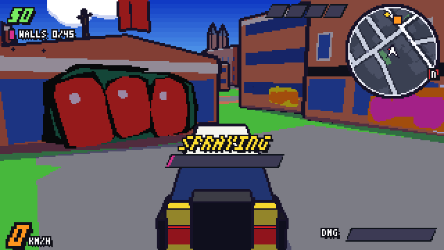<br><sub><b>Cover a rival tag.</b> Pull up to a marked wall and hold TAG: their green-and-red tag gives way to your crew's ($50).</sub></td>
    <td width="50%">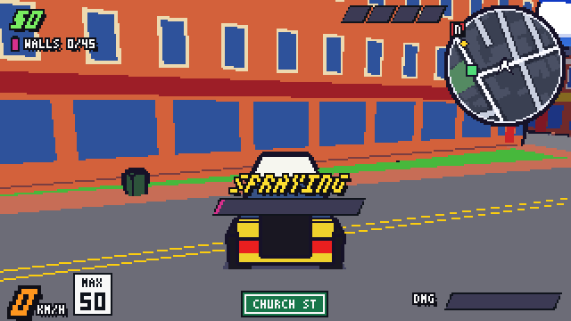<br><sub><b>Big pieces.</b> Five long walls take three sprays; the piece grows with each one ($100).</sub></td>
  </tr>
  <tr>
    <td>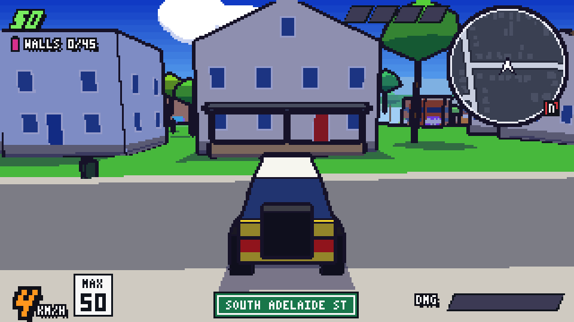<br><sub><b>Real streets.</b> Five house types with doors, trimmed windows, porches and attic windows, placed from the map.</sub></td>
    <td>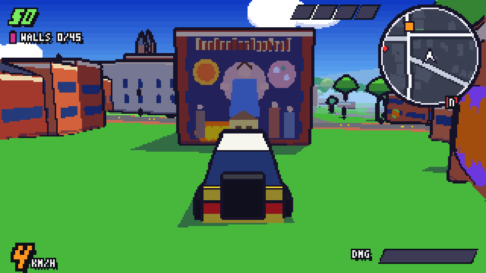<br><sub><b>Downtown.</b> Brick shop fronts, steeples, the clock tower, graffiti and the town's murals.</sub></td>
  </tr>
  <tr>
    <td>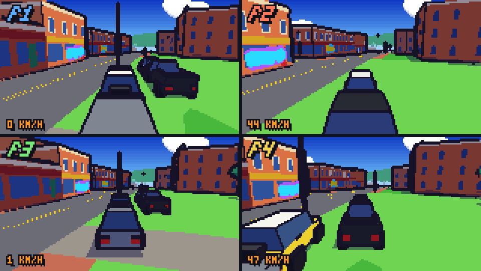<br><sub><b>Split screen.</b> Up to four players on one screen, plus Battle and VS Race.</sub></td>
    <td>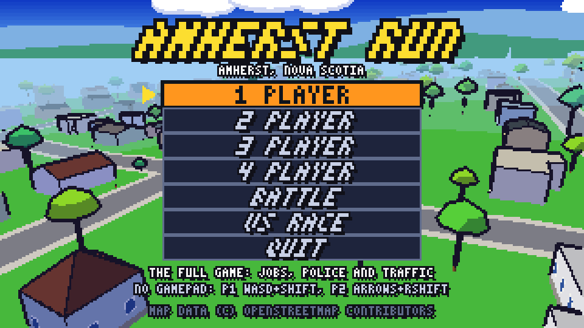<br><sub><b>Start screen.</b> Every mode, over a slowly turning view of the town.</sub></td>
  </tr>
  <tr>
    <td>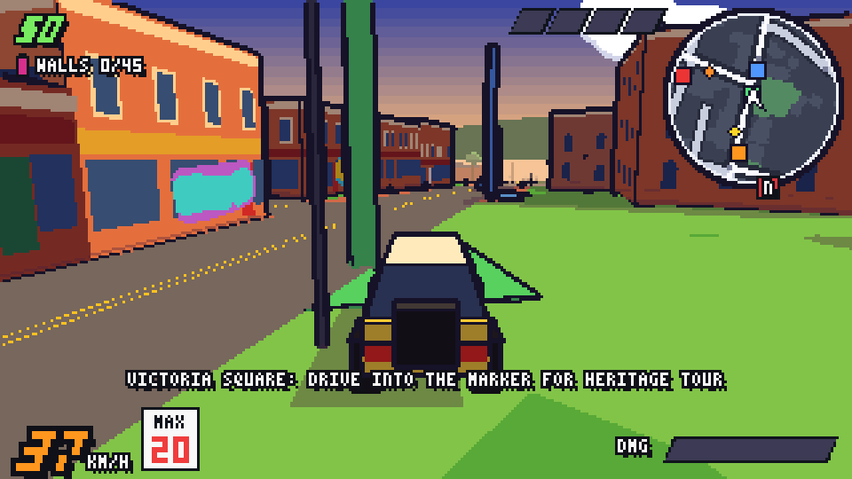<br><sub><b>Golden hour.</b> One of five weather presets (F4, or <code>--weather</code>).</sub></td>
    <td>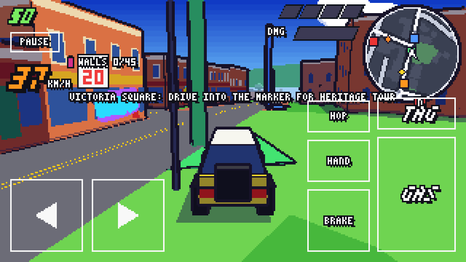<br><sub><b>On a phone.</b> Touch buttons appear at the first touch; a pad works too.</sub></td>
  </tr>
</table>

<p align="center">
  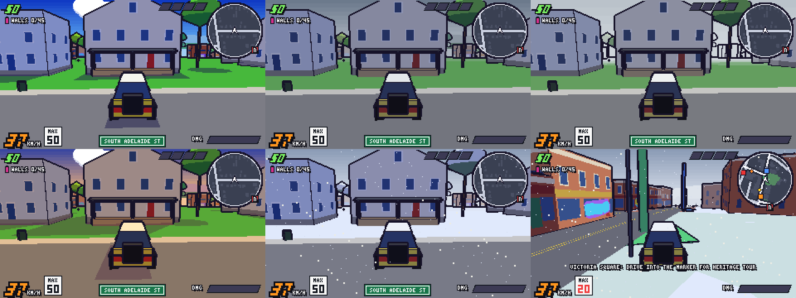<br>
  <sub>Clear, overcast, coastal fog, golden hour and snow.</sub>
</p>

## Download and install

Builds are attached to every [release](https://github.com/jeremylegere-wq/amherst-run-native/releases). All of them are
currently **untested previews**.

| Platform | File | How to install |
|---|---|---|
| **Xbox One / Series** (Developer Mode) | `amherst-run-xbox-uwp.zip` | Unzip and follow [`INSTALL.txt`](platform/uwp/INSTALL.txt): activate Developer Mode, add the package in the Device Portal, set its type to **Game**. Details in [platform/uwp](platform/uwp/README.md). |
| **Android** 5.0 and later | `amherst-run-android-debug.apk` | Allow installs from unknown sources, then open the APK. Details in [platform/android](platform/android/README.md). |
| **Linux** | build from source | See [Building from source](#building-from-source). |

Each release has a `SHA256SUMS.txt`. The newest builds of `main` are also attached to every
[CI run](https://github.com/jeremylegere-wq/amherst-run-native/actions/workflows/ci.yml) as artifacts.

## Controls

| Action | Controller | Keyboard | Touch |
|---|---|---|---|
| Steer | Left stick / D-pad | Arrows / A, D | ◀ ▶ |
| Accelerate / brake and reverse | RT / LT (or stick up / down) | Up, Down / W, S | GAS / BRAKE |
| Handbrake | A | Space | HAND |
| Hop (hold through a turn to power-slide, release to boost) | LB / RB | Shift | HOP |
| Spray a tag (hold beside a marked wall) | X | E | TAG |
| Pause | Menu or View | Esc / P | PAUSE |
| Menus | D-pad, A, B | Arrows, Enter, Esc | Tap an item |

The pause menu switches the **music**, the **quality** (low: shorter view and no see-through shadows, for slower
hardware) and the **screen fit** (safe: a border for TVs that crop their edges, the Xbox default). F4 changes the weather.
Split screen and battle keys, and every command-line option, are in [docs/COMMAND_LINE.md](docs/COMMAND_LINE.md).

## Building from source

On Linux you need a C++17 compiler, CMake 3.16 or newer, SDL2 2.30 or newer, and the OpenGL ES 3 headers:

```bash
sudo apt install build-essential cmake ninja-build libsdl2-dev libgles-dev libegl-dev
```

```bash
python3 tools/fetch_map.py
```

```bash
cmake -S . -B build -G Ninja && cmake --build build
```

```bash
ctest --test-dir build
```

```bash
./build/amherst-run
```

The map is not stored here. `tools/fetch_map.py` downloads `amherst.amr` and the golden test files from the
[amherst-run](https://github.com/jeremylegere-wq/amherst-run) release named in [`MAP_VERSION`](MAP_VERSION) and checks
their SHA-256. To use a map you baked yourself, pass `--from-dir ../amherst-run/dist`.

The Android APK and the Xbox package are built in CI ([`.github/workflows/ci.yml`](.github/workflows/ci.yml)). To
build them yourself, see [platform/android](platform/android/README.md) and [platform/uwp](platform/uwp/README.md).

## How it works

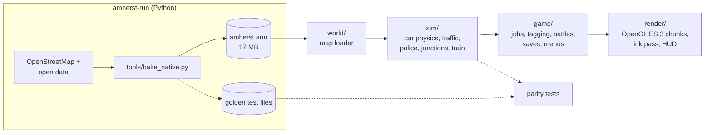

The Python game stays the reference. It bakes the town into one binary file (`amherst.amr`) and records golden test
runs. This game loads that file and reproduces the Python game's simulation exactly; the parity tests check this.
Rendering is rebuilt for the GPU: the town is cut into 200 m chunks whose meshes are made once, a normal buffer drives
the ink lines, and everything is drawn at 320x180 and scaled up with chunky pixels.

More in [docs/ARCHITECTURE.md](docs/ARCHITECTURE.md).

## Testing

`ctest` runs 12 test programs. Most replay the Python game's recorded runs and check this game does the same thing:

| Test | Checks |
|---|---|
| `world`, `drive` | Terrain heights at every golden sample; six scripted drives (into a house, up an overpass, a handbrake turn, a power slide, a hill, into a tree) follow the same path to under 2 mm. |
| `traffic` | A* routes, nearest nodes, traffic drivers at lights, stop signs and all-way stops, police chases, the wanted-level rules, and a minute of town where the cars keep moving. |
| `jobs`, `items`, `train` | Delivery addresses, routes and tours; item boxes and projectiles; the train's blocks and timetable. |
| `tagging`, `save` | Tag walls and the rules for covering, pieces and rival strikes; the save file round trip. |
| `touch`, `sound`, `music`, `math` | Touch buttons on phone-shaped screens; the synthesized effects and music (no clipping, the beat in place). |

CI builds and tests on Linux, runs the game headless, and builds the Android APK and the signed Xbox package on every push.

## Reporting a problem

On a console or phone the game writes `log.txt`, with the previous run kept as `log-previous.txt`, in its data folder.
The log records the graphics driver and version, the screen size, the connected pads and any error. On the Xbox you
can download it through the Device Portal: **File explorer > LocalAppData > AmherstRun_… > LocalState > AmherstRun >
AmherstRun**. Please attach it to an [issue](https://github.com/jeremylegere-wq/amherst-run-native/issues), together with
your device and what happened.

## Licence and credits

The code is released under the [MIT License](LICENSE). The builds include SDL2 (zlib licence) and, in the Xbox
package, Microsoft's ANGLE for Windows Store (BSD licence); see [THIRD_PARTY_NOTICES.md](THIRD_PARTY_NOTICES.md).
All art, names, music and sounds in the game are original and made in code.

The map is built by [amherst-run](https://github.com/jeremylegere-wq/amherst-run) from:

- Map data © OpenStreetMap contributors, under the [Open Database Licence](https://opendatacommons.org/licenses/odbl/)
- Nova Scotia Road Network, Nova Scotia Civic Address File, land cover and zoning: Province of Nova Scotia, Open
  Government Licence – Nova Scotia
- Building heights: Natural Resources Canada, High Resolution Digital Elevation Model (LiDAR project NS-NSDNR_2020),
  Open Government Licence – Canada
- Elevation: Terrain Tiles on AWS (Mapzen; NRCan CDEM and SRTM)
- Heritage facts: Canadian Register of Historic Places

Full credits are in the [amherst-run README](https://github.com/jeremylegere-wq/amherst-run#credits-and-licence).
