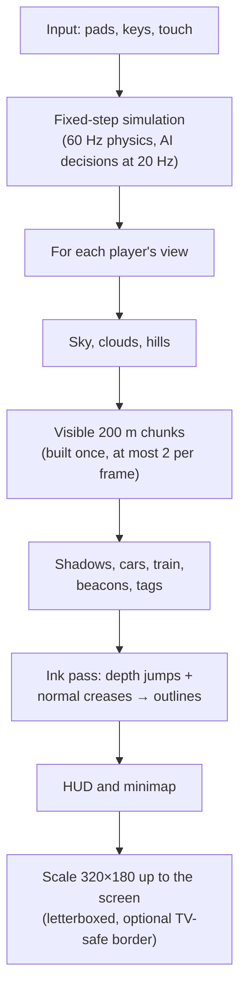

# Architecture

Amherst Run (native) is the C++ version of the [Python game](https://github.com/jeremylegere-wq/amherst-run). The
Python game stays the reference and the data pipeline: it turns open data into the town and records golden runs. This
game loads the result, reproduces the simulation exactly, and draws it with OpenGL ES 3.

## Source layout

| Folder | Contents |
|---|---|
| `src/world/` | The map loader (`map_file`) and spatial queries over it (`world`: ground height, roads, buildings and props near a point). |
| `src/sim/` | The simulation, ported from the Python game and checked against it: car physics, collisions, the road graph and A*, traffic and police drivers, junction rules, the town (heat, damage, arrests), the train. |
| `src/game/` | Everything that makes it a game: the app loop and modes (`app`), jobs, battles and items, tagging, the save file. |
| `src/render/` | The renderer: chunked map meshes, building details, cars, landmarks, the minimap, the HUD, weather, the 320×180 render target and its ink pass. |
| `src/core/` | Platform services: input (pads, keyboard, touch), synthesized sound and music, the log. |
| `platform/android/` | The Gradle and NDK project for the APK. |
| `platform/uwp/` | The CMake project, manifest and tiles for the Xbox / UWP package. |
| `tests/` | The parity and unit tests (`ctest`). |
| `tools/` | `fetch_map.py` (the map and golden files) and `make_media.sh` (the README's screenshots and GIFs). |

## The map file

`amherst.amr` is a chunked binary file written by the Python repository's `tools/bake_native.py`; that file's docstring
is the format specification. The loader reads version 1 and skips chunks it does not know, so a newer map still loads
in an older game.

| Chunks | Contents |
|---|---|
| `META` `NAME` `TERR` | Bounds, spawn, attribution, street names, the terrain height grid. |
| `ROAD` `SPAN` `PANT` `RAIL` | Roads with their type, width and speed limit; overpass decks; road paint and sidewalks; the rail line. |
| `BLDG` `BDET` `DECO` `PARK` | Building footprints, heights and roofs; their details (house type, front wall, porches, shop fronts, steeples); graffiti and murals as ready-made triangles; parked cars. |
| `POLY` `PROP` | Land use, parks and water; 464,000 props (trees, lamps, poles, fences...). |
| `GRPH` `JNCT` `TRAN` | The road graph the AI drives on, its junction rules, and the train's route. |
| `HUBS` `TOUR` `ADDR` `SPRT` | Job hubs, Heritage Tour stops, 5,610 civic addresses, race finishes. |

Anything that needs the Python game's own logic (house classification, which walls face a street, the graffiti's random
seeds) is worked out at bake time, so the native game only builds geometry from it.

## A frame

- **Chunks.** The map is cut into 200 m squares. Each chunk's meshes (ground, roads, areas, buildings with their
  details, props and static shadows) are built the first time it comes into view and then kept. Small details carry a
  draw distance in their vertex data and the shader drops them beyond it.
- **Two buffers.** The scene is drawn into a colour buffer and a normal buffer. The colour's alpha marks what gets ink
  (buildings, cars, props); the normal buffer's alpha marks surfaces whose creases get lines (not tree canopies).
- **Ink.** A full-screen pass draws a dark line where the depth jumps (silhouettes), folds (corners), or where the
  normal turns sharply. Within 30 m outlines are two pixels thick.
- **Shading.** Two-tone cel lighting from a fixed sun: the lit side keeps its colour and the shadow side drops to a
  cool blue-violet. Fog comes in bands, and a weather preset grades the colours.

## Parity with the Python game

The Python repository's `tools/golden.py` records the terrain heights, scripted drives, traffic and police runs, job
data, item flights and train runs into `golden.zip`, attached to each release with the map. The tests replay the same
inputs and compare the results. Physics is in doubles and steps exactly as the Python game does. Tolerances are tight:
under 2 mm for drives and 0.10 m for traffic, whose on/off throttle amplifies tiny differences.

## Platforms

| Platform | How it is built |
|---|---|
| Linux | CMake, the system's SDL2 and GLES. |
| Android | Gradle and the NDK build SDL2 from source and the game as `libmain.so`; SDL's Java activity runs it. |
| Xbox / UWP | On GitHub's Windows runner: SDL2's own UWP project, the game as a UWP app via CMake's WindowsStore generator, Microsoft's prebuilt ANGLE for Windows Store (OpenGL ES on Direct3D 11), signed with a test certificate made for each build. |

## Rules

- **Dependencies:** SDL2 everywhere, and ANGLE for the Xbox build. Nothing else without the project owner's approval.
- **Graphics:** OpenGL ES 3.0 only.
- **Controllers:** buttons are read by name through SDL's GameController API, never by raw button number (they differ
  between drivers).
- **World building stays in Python:** it is done by the bake and not ported.
- **Originality:** everything in the game is original. No art, names, music or sounds from other games.
