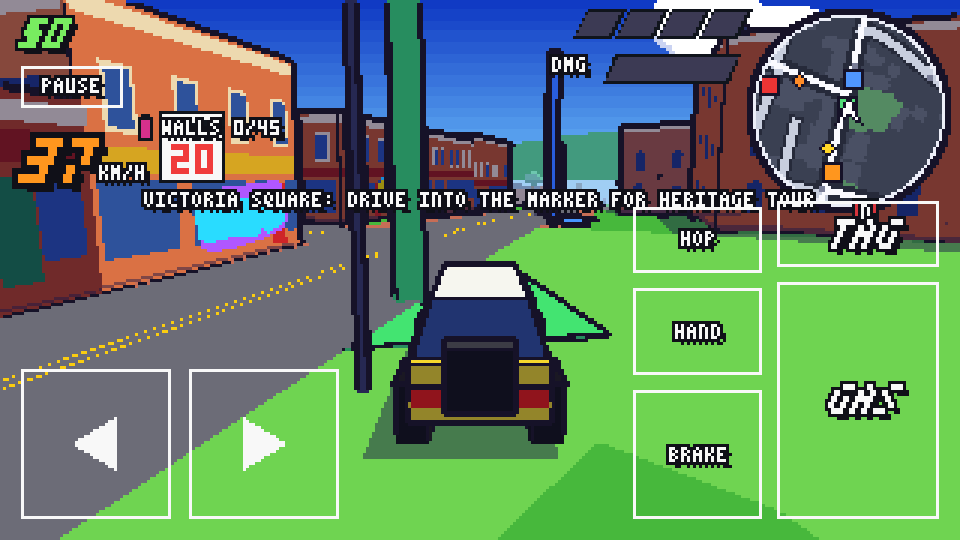

# Android

> [!WARNING]
> **Untested on a phone.** The APK is built by CI but has not yet been played on a device.



## Install

1. Download `amherst-run-android-debug.apk` from the [latest release](https://github.com/jeremylegere-wq/amherst-run-native/releases).
2. Allow installs from unknown sources for your browser or file manager when Android asks.
3. Open the APK and install it.

Or, with USB debugging on:

```bash
adb install amherst-run-android-debug.apk
```

The APK runs on Android 5.0 and later (64- and 32-bit ARM, and x86_64 emulators) and contains the map. It's
debug-signed with a key CI makes for each build, so uninstall the old version before installing a newer one.

## Playing

- **Touch.** Touch the screen and the buttons appear. Steer with your left thumb; GAS, BRAKE, HAND, HOP and TAG are
  under your right; PAUSE is top left. A thumb can slide from one button to the next. In the menus, tap an item.
- **Controller.** A Bluetooth or USB pad works too. The touch buttons hide while it is in use.
- **Back.** The phone's Back button pauses the game. Leaving the app pauses the game and its sound.
- **Slow phone?** Choose *Pause > Quality: Low* for a shorter view distance and no see-through shadows.
- **Saves and log.** Progress and `log.txt` are kept in the app's own storage.

## Building it

CI does this on every push: the `android` job in [`.github/workflows/ci.yml`](../../.github/workflows/ci.yml). To build
it yourself you need the Android SDK with an NDK and CMake, JDK 17 and Gradle 8.7:

```bash
python3 tools/fetch_map.py && mkdir -p platform/android/app/assets && cp assets/amherst.amr platform/android/app/assets/
```

Unpack the SDL2 2.32.10 source release as `platform/android/SDL2`, then:

```bash
cd platform/android && gradle assembleDebug -PndkVersion=<ndk folder name> -PcmakeVersion=<cmake folder name>
```

| File | Purpose |
|---|---|
| `app/build.gradle` | The Gradle project: package `ca.amherstrun.game`, SDK 21–34, three ABIs. |
| `app/jni/CMakeLists.txt` | Builds SDL2 from source as `libSDL2.so` and the game as `libmain.so`. |
| `AmherstRunActivity.java` | SDL's activity: landscape, full screen, OpenGL ES 3.0. |
